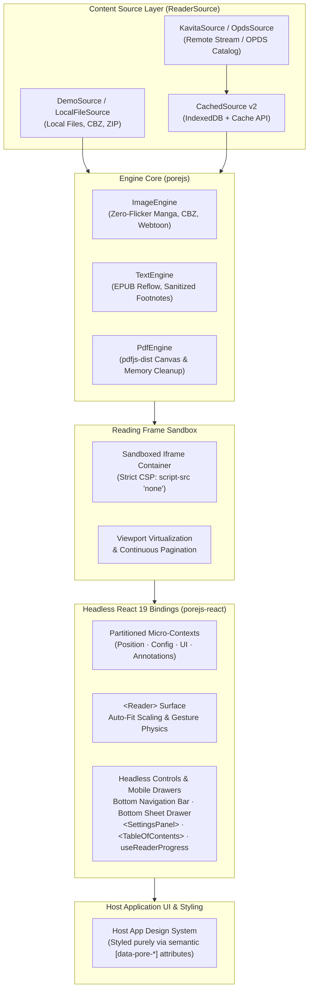

<div align="center">


# Pore.js

### Source-Agnostic Web Reader Engine for Manga, Books & Digital Text

A high-performance, source-agnostic web reader engine for manga, EPUB, PDF, and CBZ. Framework-agnostic core (`porejs`) + React 19 headless primitives (`porejs-react`) with zero-flicker pagination, mobile bottom sheets, zero shipped CSS, and offline caching.

[](https://github.com/samsmon/pore-js/actions/workflows/ci.yml)
[](https://github.com/samsmon/pore-js/releases)
[](#tech-stack--workspace-matrix)
[](#tech-stack--workspace-matrix)
[](#workspace-layout)
[](#key-features)
[](LICENSE)

[Quick Start](#quick-start) · [Architecture](#engine-architecture) · [Features](#key-features) · [Integration](#integration-guide) · [Workspace](#workspace-layout) · [Documentation](#documentation-index)

</div>

---

> Built for developers building digital libraries: a complete, headless reader engine that decouples content sources from rendering — you supply the data stream, Pore.js handles the canvas, viewport virtualization, text layout, and gesture physics.

> [!NOTE]
> **Release Status (v1.0.0-rc.2):** Latest release features dedicated mobile reader layout (bottom bar & bottom sheet drawers), zero-flicker instant manga page turns (atomic DOM swap + sync cache lookup), DOMPurify footnote security hardening, isolated multi-context state architecture, and granular subpath package exports.

---

## Engine Architecture



The engine enforces strict architectural separation across four distinct boundaries:
1. **Source Decoupling**: Data streams are ingested via abstract `ReaderSource` adapters (local files, OPDS, or remote servers) wrapped in a transparent caching layer.
2. **Framework-Agnostic Core**: Canvas rendering, pagination calculations, EPUB spine parsing, and locator offsets operate independently of any UI framework.
3. **Sandbox Isolation**: EPUB documents and untrusted markup execute inside a sandboxed iframe with strict Content Security Policy (`script-src 'none'`) and DOMPurify footnote sanitization.
4. **Headless Presentation**: React 19 bindings emit zero bundled styles and partition state into 4 micro-contexts, preventing cascading re-renders across the component tree.

---

## Key Features

<table>
  <tr>
    <td width="50%" valign="top">
      <h4>Multi-Engine Rendering &amp; Layout</h4>
      <ul>
        <li><strong>Multi-Format Support</strong>: Unified reader engine handling image manga (CBZ/ZIP), EPUB text reflow, and PDF document rendering.</li>
        <li><strong>Zero-Flicker Manga Turns</strong>: Synchronous prefetch cache lookup + atomic DOM replacement eliminating blank flashes between page flips.</li>
        <li><strong>Auto-Fit Image Scaling</strong>: Smooth cubic-bezier transitions when toggling sidebars or expanding panels without layout jumps.</li>
        <li><strong>Advanced Manga Layouts</strong>: Seamless single-page, double-page spread pairing (with spread offset), and continuous vertical/horizontal scroll.</li>
        <li><strong>Flow Directions</strong>: Right-to-Left (manga) and Left-to-Right (western comics/books) with logical RTL scrubber tick positioning.</li>
        <li><strong>EPUB Reflow &amp; Pagination</strong>: CSS multi-column pagination running inside a sandboxed iframe (<code>script-src 'none'</code>).</li>
        <li><strong>PDF Rendering Pipeline</strong>: Offscreen canvas rendering via <code>pdfjs-dist</code> with explicit <code>page.cleanup()</code> memory release.</li>
      </ul>
    </td>
    <td width="50%" valign="top">
      <h4>Headless Architecture &amp; Mobile UX</h4>
      <ul>
        <li><strong>Dedicated Mobile Layout</strong>: Compact top header, floating bottom navigation bar, ergonomic bottom sheet drawers for TOC/Settings, and safe-area insets.</li>
        <li><strong>Granular Subpath Exports</strong>: Direct imports (<code>porejs-react/reader</code>, <code>primitives</code>, <code>gsap</code>) for tree-shakeable integration without Radix bloat.</li>
        <li><strong>Zero Cascading Re-Renders</strong>: State partitioned into <code>PositionContext</code>, <code>ConfigContext</code>, <code>UIContext</code>, and <code>AnnotationsContext</code>.</li>
        <li><strong>Security Hardening</strong>: DOMPurify footnote sanitization against Stored XSS and runtime schema validation for imported annotation bundles.</li>
        <li><strong>Offline Cache &amp; Resume</strong>: <code>CachedSource</code> v2 backed by IndexedDB and Cache API with byte-budgeted chapter preloading.</li>
        <li><strong>Text-to-Speech (TTS)</strong>: Sentence-level highlight synchronization and automatic page-turn via browser <code>SpeechSynthesis</code>.</li>
        <li><strong>Annotation Engine</strong>: CSS Custom Highlight API text highlights, notes, and portable <code>epubcfi</code> locators across devices.</li>
      </ul>
    </td>
  </tr>
</table>

---

## Workspace Layout

Pore.js is maintained as a pnpm monorepo cleanly isolating core algorithms from frontend UI bindings:

| Package | Directory | Role & Responsibility |
|---|---|---|
| `porejs` | `packages/reader-core` | Framework-agnostic reader core: sources, image/text/PDF engines, locator model, worker search |
| `porejs-react` | `packages/reader-react` | React 19 headless primitives: `<Reader>`, micro-contexts, custom hooks, and UI controls |
| `@pore/demo` | `apps/demo` | Public demo application showcasing mobile layout, dark mode, and synthetic fixtures |
| `@pore/example-host-app` | `examples/host-app` | Minimal third-party embedding reference illustrating host integration |

---

## Tech Stack & Workspace Matrix

| Layer | Technology | Purpose |
|---|---|---|
| **Core Engine** | TypeScript 5.7+ | Strict type safety, engine algorithms, zero-dependency core architecture |
| **UI Bindings** | React 19 | Headless components, compound micro-contexts, declarative reactive hooks |
| **Text & PDF** | CSS Multi-Column / `pdfjs-dist` | Sandboxed EPUB reflow and canvas-based document rendering |
| **Offline Storage** | IndexedDB + Cache API | Resilient progress checkpoints, blob storage, and offline media cache |
| **Tooling & Test** | Vite 6 / tsup / Vitest / Playwright | Monorepo bundling, unit tests, and cross-browser e2e verification |

---

## Quick Start

### Prerequisites
- **Node.js** >= 20.0.0
- **pnpm** >= 9.0.0 (`corepack enable`)

### Monorepo Development

```bash
# 1. Enable corepack and install workspace dependencies
corepack enable
pnpm install

# 2. Generate synthetic CC0 demo fixtures (manga, EPUB, PDF)
pnpm gen:fixtures

# 3. Start local development server (demo app on http://localhost:5173)
pnpm dev

# 4. Verify test suites and build output
pnpm test          # Run Vitest across reader-core and reader-react
pnpm typecheck     # Typecheck all packages and applications via tsc
pnpm lint          # Run workspace code quality linters
pnpm build         # Build distributable packages via tsup and Vite

# 5. Run end-to-end browser tests
pnpm --filter @pore/demo e2e:install   # One-time Playwright browser download
pnpm --filter @pore/demo e2e           # Run e2e test suite across browsers
```

---

## Integration Guide

### 1. Basic React Integration

Install the packages in your project and mount `<Reader>` inside a `ReaderProvider`. You can import the full bundle or use granular subpath exports:

```tsx
import { ReaderProvider } from 'porejs-react';
import { Reader } from 'porejs-react/reader';
import { CachedSource, DemoSource } from 'porejs';

// Initialize data source (wrap in CachedSource for offline caching & resume)
const source = new CachedSource(new DemoSource());

export function ReaderView() {
  return (
    <ReaderProvider source={source}>
      <main className="reader-container">
        {/* Headless reader surface styled via [data-pore-*] CSS selectors */}
        <Reader bookId="demo-book" className="reader-host" />
      </main>
    </ReaderProvider>
  );
}
```

### 2. Headless Component Primitives

The `porejs-react` package exports unstyled headless components and hooks for building custom reader chrome:

- **Components**: `<SettingsPanel>`, `<TableOfContents>`, `<HighlightsPanel>`, `<ReaderScrubber>`, `<FootnotePopover>`, `<ReaderAnnouncer>`.
- **Hooks**: `useReaderProgress()`, `useReaderLocation()`, `useReaderSettings()`, `useReaderSearch()`, `useDownload()`, `useTts()`, `useBookmarks()`.
- **Subpaths**: `porejs-react/reader` (minimal headless reader), `porejs-react/primitives` (UI building blocks), `porejs-react/gsap` (animation adapter).

### 3. Custom Sources

To connect a proprietary backend or digital catalog, implement the `ReaderSource` interface:

```ts
import type { ReaderSource, Manifest, Position, Page } from 'porejs';

export class CustomLibrarySource implements ReaderSource {
  async getManifest(bookId: string): Promise<Manifest> {
    const res = await fetch(`/api/books/${bookId}/manifest`);
    return res.json();
  }

  async getPage(bookId: string, pageIndex: number): Promise<Page> {
    const res = await fetch(`/api/books/${bookId}/pages/${pageIndex}`);
    return res.json();
  }

  async loadProgress(bookId: string): Promise<Position | null> {
    const saved = localStorage.getItem(`progress:${bookId}`);
    return saved ? JSON.parse(saved) : null;
  }

  async saveProgress(bookId: string, position: Position): Promise<void> {
    localStorage.setItem(`progress:${bookId}`, JSON.stringify(position));
  }
}
```

---

## Documentation Index

Comprehensive technical specifications, design RFCs, and operational runbooks are maintained in the [`docs/`](docs/) directory:

| Document | Scope & Focus | Target Audience |
|---|---|---|
| [Getting Started](docs/getting-started.md) | First steps, fixture creation, and local app configuration | New Developers |
| [Architecture Guide](docs/architecture.md) | Internal engine mechanics, CSP sandboxing, and data lifecycles | System Architects |
| [Integration Guide](docs/integration.md) | In-depth API reference for `ReaderSource`, hooks, and headless UI | Frontend Engineers |
| [AI Agent Guide](docs/ai-agent-guide.md) | Monorepo invariants, automation rules, and development conventions | AI Coding Agents |
| [Milestone 8 Plan](docs/m8-plan.md) | Hardening roadmap, API freeze checklist, and release gates | Core Contributors |
| [Changelog](CHANGELOG.md) | Release history, breaking changes, and version notes | All Developers |

---

## License

Distributed under the [MIT License](LICENSE).

[↑ Back to top](#porejs)
